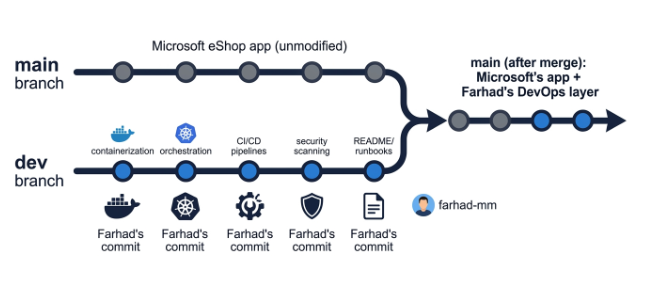

# About This Project — Application vs. My DevOps Work

## The Application (main branch)
The `main` branch contains Microsoft's official eShop reference application (https://github.com/dotnet/eShop) — a .NET microservices sample app. This code is unmodified and is not my work.

## My DevOps Transformation (dev branch — you are here)
My task was to take this existing application and operate it like a real production system. This branch documents and implements:

- **Containerization**: Dockerfiles and docker-compose integration for Catalog.API, Basket.API, and Ordering.API
- **Kubernetes deployment**: ConfigMaps, Secrets, Deployments, and Services, deployed to a self-managed k3s cluster on a Proxmox homelab
- **CI/CD pipeline**: GitHub Actions workflow — build, test, push images to GHCR, and automated deploy
- **Security**: Trivy container vulnerability scanning + repository secret scanning integrated into the pipeline
- **Reliability**: Deployment smoke tests and a documented Kubernetes rollback/disaster-recovery runbook with evidence

Every commit on this branch is authored and pushed by me (@farhad-mm) — see the commit history for full detail.
